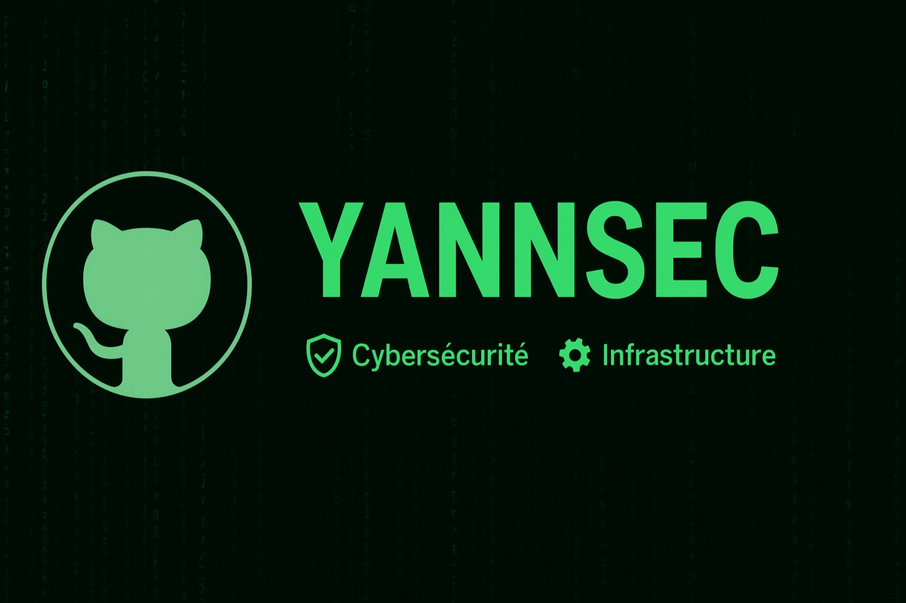

<h1 align="center">💻 Portfolio – Systèmes, Réseaux & Sécurité</h1>

  
  
  
  

---

  

---

## 🧠 À propos

Technicien supérieur systèmes et réseaux, titre **Administrateur d'Infrastructures Sécurisées (AIS, niveau 6)**, avec **un an de support N2** en alternance.

Ce dépôt regroupe mes projets, procédures et études techniques autour de l'**administration systèmes**, de la **supervision**, de l'**automatisation** et de la **cybersécurité**.

---

## 🧰 Compétences

| Domaine | Outils / Technologies |
| ------- | --------------------- |
| 🛡️ **Supervision & sécurité** | Wazuh, Suricata, fail2ban, Wireshark |
| ⚙️ **Automatisation** | Ansible, PowerShell |
| 🖥️ **Systèmes** | Windows Server, Active Directory, Debian |
| 🌐 **Réseau** | HSRP, SNMP, analyse de trafic |
| 🧾 **Exploitation** | GLPI, Apache Guacamole, MariaDB, Nginx |

---

## 🚀 Projets

### 🧾 Mise en place de GLPI
Gestion de parc et helpdesk : analyse des besoins, prérequis, sécurité, déploiement. Le PDF regroupe le rapport de projet et ses annexes (DAT, procédures d'installation et de déploiement de l'agent).
- 📘 [Rapport de projet et annexes (PDF)](./projets/GLPI/Projet_GLPI_Rapport_et_annexes.pdf)

### 🛡️ Supervision de sécurité avec Wazuh
Déploiement de Wazuh, détection d'incidents (injection SQL, brute force, FIM, Suricata).
- [➡️ Voir le projet](./projets/Wazuh)

### 🤖 Automatisation avec Ansible
- [➡️ Voir le projet](./projets/Ansible)

---

## 📚 Documentation technique

| Document | Description |
| -------- | ----------- |
| 📊 [Analyse de la sécurité du trafic réseau](./documentation/Analyser_La_Sécurité_Du_Trafic_Réseau.md) | Wireshark : DHCP, DNS, HTTP, TLS, SMB, Kerberos, WinRM, SSH |
| 🔐 [Mécanismes cryptographiques](./documentation/Mécanisme_cryptographiques_dans_un_si.md) | Cryptographie dans un système d'information |
| 🕷️ [OWASP](./documentation/OWASP.md) | Vulnérabilités web et bonnes pratiques |
| 🚪 [Étude comparative des bastions](./documentation/Etude_comparative_des_differentes_solutions_Bastions.md) | Azure, Guacamole, Teleport |
| 🧪 [DAT du lab de test](./documentation/DAT_LAB_Environnement_de_Test.md) | Environnement AD + Linux |
| 🔁 [HSRP](./documentation/HSRP.md) | Redondance de passerelle Cisco |
| 💻 [PowerShell](./documentation/PowerShell.md) | Exercices et exemples |
| 🎓 [Sensibilisation cybersécurité](./documentation/Sensibilisation_Cybersécurité.md) | Support de sensibilisation |

---

## 🧑‍💻 Auteur

**Yann (Y4nnSec)**
🔗 [Profil GitHub](https://github.com/Y4nnSec)
⚙️ Passionné par la **cybersécurité**, la **virtualisation**, l'**automatisation** et les **systèmes & réseaux**