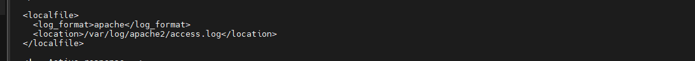
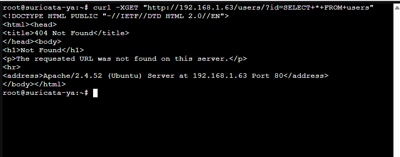
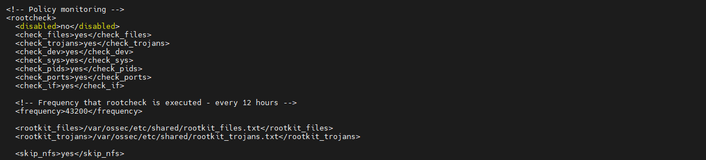
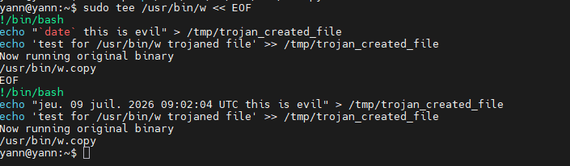
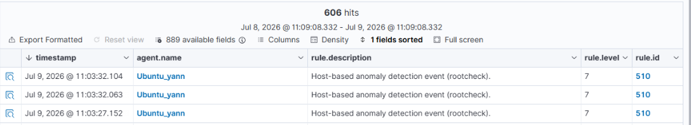

<p align="center">
  
</p>


**Auteur** : Yann (Administrateur Infrastructure Sécurisée)

**Projet** : Juin 2026


* Intégration de l'IDS Suricata : https://documentation.wazuh.com/current/proof-of-concept-guide/integrate-network-ids-suricata.html

# Intégration d'un NIDS (Suricata) avec Wazuh

L'intégration d'un système de détection d'intrusions réseau (NIDS) permet d'améliorer la détection des menaces en surveillant et en analysant le trafic réseau. 

Ce cas d'usage démontre comment intégrer Suricata avec Wazuh. Suricata fournit une visibilité supplémentaire sur la sécurité du réseau grâce à ses capacités d'inspection du trafic en temps réel.

## 1. Infrastructure requise

* **Machine cible (Endpoint) :** Un serveur sous **Ubuntu 22.04** avec l'agent Wazuh préalablement installé. 
* **Rôle :** C'est sur cette machine qu'est installé Suricata. Wazuh surveillera et analysera le trafic réseau généré et intercepté sur ce point de terminaison.

## 2. Installation et configuration de Suricata

Les étapes suivantes permettent de configurer Suricata sur la machine cible et d'envoyer les journaux générés vers le serveur Wazuh.

### 2.1 Installation des paquets

Ajouter le dépôt officiel, mettre à jour la liste des paquets et installer Suricata :

```bash
sudo add-apt-repository ppa:oisf/suricata-stable
sudo apt-get update
sudo apt-get install suricata -y
```


.png)
.png)

### 2.2 Téléchargement des règles de détection

**Télécharger et extraire le jeu de règles Emerging Threats pour Suricata :**

```bash  
cd /tmp/ && curl -LO [https://rules.emergingthreats.net/open/suricata-6.0.8/emerging.rules.tar.gz](https://rules.emergingthreats.net/open/suricata-6.0.8/emerging.rules.tar.gz)
sudo tar -xvzf emerging.rules.tar.gz && sudo mkdir -p /etc/suricata/rules && sudo mv rules/*.rules /etc/suricata/rules/
sudo find /etc/suricata/rules -name "*.rules" -exec chmod 777 {} \;
```  


.png)
.png)
  
### 2.3 Configuration de Suricata

Il est nécessaire de modifier les paramètres de Suricata dans le fichier */etc/suricata/suricata.yaml* afin de définir le réseau à surveiller et l'interface réseau.

**Définir les variables de réseau :**
  
```YAML
HOME_NET: "<IP_DE_LA_MACHINE_UBUNTU_22.04>"
EXTERNAL_NET: "any"

default-rule-path: /etc/suricata/rules
rule-files:
  - "*.rules"

# Configuration globale des statistiques
stats:
  enabled: yes
```  
  
Définir l'interface réseau à écouter (remplacer *enp0s3* par le nom réel de l'interface de la machine, qui peut être obtenu via la commande *ip a* :
  
```YAML  
# Prise en charge de la capture haute vitesse Linux
af-packet:
  - interface: enp0s3 
```  
  


Redémarrer le service Suricata pour appliquer les modifications :
  
```BASH  
sudo systemctl restart suricata  
```  
  
## 3. Configuration de l'agent Wazuh

Afin que l'agent Wazuh puisse lire et transmettre les alertes générées par Suricata, il faut modifier la configuration locale de l'agent.

Ajouter le bloc de configuration suivant dans le fichier */var/ossec/etc/ossec.conf* de la machine cible (Ubuntu) :  
  
```XML  
 <ossec_config>
  <localfile>
    <log_format>json</log_format>
    <location>/var/log/suricata/eve.json</location>
  </localfile>
</ossec_config> 
```  


  
Redémarrer l'agent Wazuh pour appliquer les changements :
  
```BASH  
sudo systemctl restart wazuh-agent  
```  
  
## 4. Simulation d'attaque et vérification

Wazuh analyse désormais automatiquement les données du fichier */var/log/suricata/eve.json* et génère les alertes correspondantes sur le tableau de bord.

### 4.1 Émulation
Pour vérifier le bon fonctionnement, générer un trafic ICMP (Ping) depuis le serveur Wazuh (ou une autre machine) vers la machine cible Ubuntu surveillée par Suricata :

```Bash  
 ping -c 20 "<IP_DE_LA_MACHINE_UBUNTU>" 
```  
  


### 4.2 Visualisation des alertes

Il est possible de visualiser les données d'alerte directement dans le tableau de bord Wazuh.

Pour ce faire :

* Accéder au module Threat Hunting.

* Ajouter le filtre suivant dans la barre de recherche pour isoler les événements du NIDS : rule.groups:suricata.


## 5. Dépannage (Troubleshooting)

En cas d'erreur de démarrage de Suricata, il est fréquent de rencontrer l'erreur suivante dans les journaux (*/var/log/suricata/suricata.log*) :

```plaintext  
16/9/2022 -- 12:32:16 - <Error> - [ERRCODE: SC_ERR_AFP_CREATE(190)] - Unable to find iface eth0: No such device
16/9/2022 -- 12:32:16 - <Error> - [ERRCODE: SC_ERR_AFP_CREATE(190)] - Couldn't init AF_PACKET socket, fatal error
``` 
  
**Résolution :** Ce problème survient lorsque le nom de l'interface réseau renseigné dans la configuration est incorrect. Il convient de vérifier le nom exact de l'interface réseau disponible sur le système (*ip a*) et de corriger la directive interface dans le fichier */etc/suricata/suricata.yaml*.

* Surveillance de l'intégrité de répertoires/fichiers sensibles : https://documentation.wazuh.com/current/proof-of-concept-guide/poc-file-integrity-monitoring.html

# Surveillance de l'intégrité des fichiers (FIM)

Le contrôle d'intégrité des fichiers (File Integrity Monitoring - FIM) permet d'auditer les fichiers sensibles et de répondre aux exigences de conformité réglementaire. Wazuh dispose d'un module FIM intégré qui surveille les modifications du système de fichiers afin de détecter la création, la modification et la suppression de fichiers.

Ce cas d'usage exploite le module FIM de Wazuh pour détecter les modifications dans des répertoires surveillés sur des points de terminaison Linux et Windows. Le module enrichit les données d'alerte en récupérant des informations sur l'utilisateur et le processus à l'origine des modifications.

## 1. Infrastructure requise

* **Serveur Linux (Ubuntu 22.04) :** Le module FIM surveillera un répertoire spécifique sur cette machine cible pour détecter les changements de fichiers.
* **Poste Client (Windows 11) :** Le module FIM surveillera un répertoire spécifique sur ce point de terminaison pour détecter les mêmes types d'événements.

## 2. Configuration

### 2.1 Configuration de la machine cible Ubuntu

Les étapes suivantes permettent de configurer l'agent Wazuh pour surveiller les modifications du système de fichiers dans le répertoire `/root` (ou tout autre répertoire de test).

1. Éditer le fichier de configuration de l'agent Wazuh `/var/ossec/etc/ossec.conf`. 
2. Ajouter le répertoire à surveiller dans le bloc `<syscheck>`. Pour obtenir des informations supplémentaires (audit complet en temps réel et reporting des changements), la configuration suivante doit être utilisée :

```xml
<directories check_all="yes" report_changes="yes" realtime="yes">/root</directories>
```


1. Redémarrer l'agent Wazuh pour appliquer les modifications de configuration :

```bash
sudo systemctl restart wazuh-agent
```


### 2.2 Configuration de la machine cible Windows

Les étapes suivantes permettent de configurer l'agent Wazuh pour surveiller les modifications dans le répertoire du bureau de l'utilisateur.

1. Ouvrir le fichier de configuration *C:\Program Files (x86)\ossec-agent\ossec.conf* sur la machine Windows surveillée (avec des droits d'administrateur).

2. Ajouter le répertoire à surveiller dans le bloc <*syscheck*>. Il faut remplacer <*USER_NAME*> par le nom de l'utilisateur de la session Windows 11 :

```XML
<directories check_all="yes" report_changes="yes" realtime="yes">C:\Users\<USER_NAME>\Desktop</directories>
```


1. Redémarrer le service de l'agent Wazuh à l'aide de PowerShell (lancé en tant qu'administrateur) pour appliquer les changements :

```PowerShell
Restart-Service -Name wazuh
```

## 3. Test et simulation

Afin de vérifier que le module FIM remonte correctement les informations, il faut simuler une activité suspecte sur les deux machines (Ubuntu et Windows) dans les répertoires surveillés :

1. Créer un fichier texte dans le répertoire surveillé.

2. Attendre 5 secondes.

3. Ajouter du contenu au fichier texte, puis l'enregistrer.

4. Attendre 5 secondes.

5. Supprimer le fichier texte du répertoire surveillé.

## 4. Visualisation des alertes

Il est possible de visualiser les données d'alerte générées par ces actions directement dans le tableau de bord Wazuh.

Pour ce faire :

1. Se rendre dans le module File Integrity Monitoring (ou Threat Hunting) de l'interface web.

2. Ajouter le filtre suivant dans la barre de recherche pour interroger spécifiquement les alertes de création, modification et suppression de fichiers :

   * rule.id: is one of 550,553,554


* Détection d'attaques bruteforce : https://documentation.wazuh.com/current/proof-of-concept-guide/detect-brute-force-attack.html

# Détection d'une attaque par force brute (Brute-force)

L'attaque par force brute est un vecteur d'attaque courant utilisé par des acteurs malveillants pour obtenir un accès non autorisé à des points de terminaison et à des services. Les services tels que SSH sur les serveurs Linux et RDP sur les postes Windows sont particulièrement exposés à ce type de menace. Wazuh identifie ces attaques en corrélant plusieurs événements d'échec d'authentification successifs.

Ce cas d'usage démontre comment simuler et détecter une attaque par force brute visant les protocoles SSH et RDP.

## 1. Infrastructure requise

Afin de réaliser ce scénario, trois rôles (ou machines) sont nécessaires :
* **Machine de l'attaquant :** Un système Linux (ex: Ubuntu) depuis lequel l'attaque sera lancée. *Note : Dans un environnement de laboratoire restreint, la machine hébergeant la sonde Suricata peut jouer ce rôle.*
* **Cible Linux (Ubuntu 24.04) :** La victime des attaques SSH. Il est requis d'avoir un serveur SSH installé, activé et supervisé par l'agent Wazuh sur cette machine.
* **Cible Windows (Windows 11) :** La victime des attaques RDP. Le bureau à distance (RDP) doit être activé sur ce point de terminaison.

## 2. Configuration de l'attaquant

Les étapes suivantes permettent de configurer la machine de l'attaquant pour générer des tentatives d'authentification échouées sur les cibles.

Sur la machine de l'attaquant, installer l'outil de sécurité **Hydra**, qui permet d'exécuter l'attaque par dictionnaire :

```bash
sudo apt update
sudo apt install -y hydra
```


## 3. Émulation de l'attaque

### 3.1 Préparation du dictionnaire

Créer un fichier texte contenant une liste de mots de passe aléatoires (par exemple, 10 mots de passe erronés) qui serviront pour l'attaque.

```bash
nano pass.txt
```


### 3.2 Attaque contre le serveur Linux (SSH)

Exécuter Hydra depuis la machine de l'attaquant pour lancer l'attaque par force brute contre le service SSH. Remplacer <*IP_LINUX*> par l'adresse IP de la cible Ubuntu surveillée :

```bash
sudo hydra -l badguy -P pass.txt ssh://<IP_LINUX>
```

(Variante de syntaxe selon la version d'Hydra : *sudo hydra -l badguy -P pass.txt <IP_LINUX> ssh*)


### 3.3 Attaque contre le poste Windows (RDP)

De la même manière, exécuter Hydra pour cibler le service Bureau à distance (RDP) du poste client Windows. Remplacer <*IP_WINDOWS*> par l'adresse IP de la cible Windows 11 :

```bash
sudo hydra -l badguy -P pass.txt rdp://<IP_WINDOWS>
```


## 4. Visualisation des alertes

Une fois les attaques lancées, les échecs d'authentification répétés sont automatiquement analysés par Wazuh, qui va déclencher des alertes de sécurité de niveau critique ou élevé.

Il est possible de visualiser ces données directement dans le tableau de bord.
Pour ce faire :

1. Accéder au module Threat Hunting dans l'interface web de Wazuh.

2. Ajouter les filtres suivants dans la barre de recherche pour interroger les alertes spécifiques à ces attaques :

Pour la cible Linux (SSH) :

* rule.id:(5551 OR 5712)
(D'autres règles connexes peuvent également apparaître, telles que 5710, 5711, 5716, 5720, 5503, 5504).


Pour la cible Windows (RDP) :

* rule.id:(60122 OR 60204)


* Détection de processus non autorisés : https://documentation.wazuh.com/current/proof-of-concept-guide/detect-unauthorized-processes-netcat.html

# Détection de processus non autorisés (Monitoring de commandes)

La fonctionnalité de surveillance des commandes de Wazuh permet d'exécuter périodiquement des instructions sur un point de terminaison et d'en analyser la sortie. 

Ce cas d'usage exploite cette capacité pour détecter l'exécution d'un processus spécifique non autorisé, en l'occurrence **Netcat** (souvent utilisé de manière illégitime pour l'écoute ou le balayage de ports), sur une machine cible.

## 1. Infrastructure requise

* **Machine cible (Endpoint) :** Un serveur sous **Ubuntu 24.04**. Le module de surveillance des commandes y sera configuré pour détecter le lancement du processus Netcat.
* **Serveur Wazuh (Manager) :** Le serveur central qui hébergera les règles de détection personnalisées.

## 2. Configuration de la machine cible (Ubuntu)

Les étapes suivantes permettent de configurer la surveillance des commandes afin d'interroger périodiquement la liste des processus en cours d'exécution.

1. Ajouter le bloc de configuration suivant dans le fichier `/var/ossec/etc/ossec.conf` de l'agent Wazuh. Cela permet d'exécuter la commande `ps` toutes les 30 secondes :

```xml
<ossec_config>
  <localfile>
    <log_format>full_command</log_format>
    <alias>process list</alias>
    <command>ps -e -o pid,uname,command</command>
    <frequency>30</frequency>
  </localfile>
</ossec_config>
```


2. Redémarrer l'agent Wazuh pour appliquer les modifications :

```bash
sudo systemctl restart wazuh-agent
```

3. Installer Netcat (et ses dépendances) sur cette machine pour pouvoir simuler l'attaque ultérieurement :

```bash
sudo apt install ncat nmap -y
```


## 3. Configuration du serveur Wazuh (Manager)

Il est ensuite nécessaire de créer une règle personnalisée sur le serveur central pour qu'une alerte soit déclenchée chaque fois que le programme Netcat passe en mode écoute.

1. Ajouter les règles suivantes dans le fichier */var/ossec/etc/rules/local_rules.xml* sur le serveur Wazuh :

```XML
<group name="ossec,">
  <rule id="100050" level="0">
    <if_sid>530</if_sid>
    <match>^ossec: output: 'process list'</match>
    <description>List of running processes.</description>
    <group>process_monitor,</group>
  </rule>

  <rule id="100051" level="7" ignore="900">
    <if_sid>100050</if_sid>
    <match>nc -l</match>
    <description>netcat listening for incoming connections.</description>
    <group>process_monitor,</group>
  </rule>
</group>
```


2. Redémarrer le service Wazuh Manager pour compiler et appliquer ces nouvelles règles :

```BASH
sudo systemctl restart wazuh-manager
```

## 4. Émulation de l'attaque

Pour vérifier le bon fonctionnement de la règle, il faut simuler le lancement d'un processus non autorisé sur la machine cible.

Sur la machine Ubuntu surveillée, exécuter la commande Netcat en mode écoute sur le port 8000 et la laisser tourner pendant au moins 30 secondes (pour laisser le temps au script de l'agent de s'exécuter) :

```BASH
nc -l 8000
```


## 5.  Visualisation des alertes
Les données d'alerte peuvent désormais être consultées dans le tableau de bord Wazuh.

Pour ce faire :

1. Accéder au module Threat Hunting.

2. Ajouter le filtre suivant dans la barre de recherche pour isoler spécifiquement la règle personnalisée fraîchement créée :

   * rule.id:(100051)


* Détection de tentatives d'injection SQL : https://documentation.wazuh.com/current/proof-of-concept-guide/detect-web-attack-sql-injection.html

# Détection d'une attaque par injection SQL (SQLi)

L'injection SQL est une attaque par laquelle un acteur malveillant insère du code non autorisé dans des chaînes de caractères transmises à un serveur de base de données pour être analysées et exécutées. Une attaque réussie permet d'obtenir un accès illégitime aux informations confidentielles de la base de données.

Wazuh permet de détecter ces tentatives en analysant les journaux du serveur web à la recherche de modèles courants d'injection SQL (comme les mots-clés `SELECT`, `UNION`, etc.).

Ce cas d'usage démontre comment configurer la surveillance d'un serveur web Apache et détecter une simulation d'attaque par injection SQL.

## 1. Infrastructure requise

* **Cible (Victime) :** Un serveur sous **Ubuntu 22.04** hébergeant un serveur web Apache (version 2.4.x). L'agent Wazuh y est configuré pour lire les journaux d'accès web.
* **Attaquant :** Une machine distante (ex: RHEL, Ubuntu ou la machine hôte) depuis laquelle la requête web malveillante sera lancée.

## 2. Configuration de la machine cible (Ubuntu)

Les étapes suivantes permettent d'installer le serveur web Apache et de configurer l'agent Wazuh pour en surveiller les journaux (logs).

### 2.1 Installation et vérification d'Apache

1. Mettre à jour les paquets locaux et installer le serveur web Apache :

```bash
sudo apt update
sudo apt install apache2 -y
```

1. Si le pare-feu (UFW) est activé sur le système, il est nécessaire d'autoriser le trafic web entrant. (Si le pare-feu est inactif, cette étape peut être ignorée) :

```bash
sudo ufw app list
sudo ufw allow 'Apache'
sudo ufw status
```

2. Vérifier que le service Apache est bien en cours d'exécution :

```bash
sudo systemctl status apache2
```

3. Valider l'accès au serveur web en utilisant la commande *curl* localement ou en ouvrant un navigateur web vers *http://<IP_DE_LA_MACHINE_UBUNTU>* pour afficher la page d'accueil par défaut d'Apache.


### 2.2 Configuration de l'agent Wazuh

Afin que Wazuh puisse analyser les requêtes web entrantes, l'agent doit être instruit de lire le fichier de journalisation d'Apache.

Ajouter les lignes suivantes au fichier de configuration de l'agent Wazuh */var/ossec/etc/ossec.conf* :

```xml
<ossec_config>
  <localfile>
    <log_format>apache</log_format>
    <location>/var/log/apache2/access.log</location>
  </localfile>
</ossec_config>
```



1. Redémarrer l'agent Wazuh pour appliquer les modifications de configuration :

```bash
sudo systemctl restart wazuh-agent
```

3. Émulation de l'attaque
Pour tester la détection, il convient d'exécuter une requête HTTP contenant une charge utile (payload) d'injection SQL basique.

Depuis la machine de l'attaquant, exécuter la commande suivante (en remplaçant <IP_UBUNTU> par l'adresse IP de la cible) :

```bash
curl -XGET "http://<IP_UBUNTU>/users/?id=SELECT+*+FROM+users";
```



## 4. Visualisation des alertes

La requête malveillante a été enregistrée dans le fichier access.log d'Apache. L'agent Wazuh l'a transmise au Manager qui a identifié le modèle d'injection SQL.

Les données d'alerte peuvent être visualisées dans le tableau de bord Wazuh.
Pour ce faire :

1. Accéder au module Threat Hunting.

2. Ajouter l'un des filtres suivants dans la barre de recherche :

   * rule.id: 31103 (Détecte une attaque par injection SQL générique via requête web)

   * rule.id: 31106 (Détecte une tentative d'injection SQL qui a potentiellement réussi - code HTTP 200)


* Détection de cheval de troie : https://documentation.wazuh.com/current/proof-of-concept-guide/poc-detect-trojan.html

# Détection de fichiers binaires suspects (Cheval de Troie)

Wazuh possède des capacités de détection d'anomalies et de malwares permettant d'identifier des binaires suspects sur un point de terminaison. Les binaires sont des fichiers exécutables conçus pour effectuer des tâches automatisées. Les acteurs malveillants utilisent souvent des binaires altérés (chevaux de Troie) pour exploiter un système tout en évitant d'être détectés.

Ce cas d'usage démontre comment le module Rootcheck de Wazuh peut détecter un binaire système infecté par un cheval de Troie sur un point de terminaison Ubuntu. L'attaque consiste à remplacer le contenu d'un binaire légitime par du script malveillant afin de tromper le système pour qu'il l'exécute.

## 1. Infrastructure requise

* **Machine cible (Endpoint)** : Un serveur sous Ubuntu (par exemple la VM Ubuntu 22.04 ou 22.04 déjà utilisée) avec l'agent Wazuh préalablement installé.

* **Rôle** : C'est sur cette machine que le module Rootcheck analysera l'intégrité des fichiers et que l'infection du binaire sera simulée.

## 2. Configuration de l'agent Wazuh

Par défaut, le module Rootcheck est activé dans le fichier de configuration de l'agent Wazuh. Il convient de s'en assurer sur la machine cible.

1. Éditer le fichier de configuration de l'agent Wazuh */var/ossec/etc/ossec.conf* sur la machine Ubuntu.

2. Vérifier que le bloc <rootcheck> contient bien les balises suivantes, sans lesquelles l'analyse des fichiers ne pourrait pas s'effectuer :

```xml
<rootcheck>
    <disabled>no</disabled>
    <check_files>yes</check_files>

    <!-- Line for trojans detection -->
    <check_trojans>yes</check_trojans>

    <check_dev>yes</check_dev>
    <check_sys>yes</check_sys>
    <check_pids>yes</check_pids>
    <check_ports>yes</check_ports>
    <check_if>yes</check_if>

    <!-- Frequency that rootcheck is executed - every 12 hours -->
    <frequency>43200</frequency>
    <rootkit_files>/var/ossec/etc/shared/rootkit_files.txt</rootkit_files>
    <rootkit_trojans>/var/ossec/etc/shared/rootkit_trojans.txt</rootkit_trojans>
    <skip_nfs>yes</skip_nfs>
</rootcheck>
```



(Si des modifications ont dû être apportées, redémarrer l'agent Wazuh avec la commande *sudo systemctl restart wazuh-agent*).

## 3. Émulation de l'attaque

Pour simuler l'attaque, nous allons compromettre un utilitaire système natif, le programme */usr/bin/w* (qui sert normalement à afficher les utilisateurs connectés au système), en le remplaçant par un script malveillant.

### 3.1 Création du cheval de Troie

Sur la machine cible (Ubuntu), exécuter les commandes suivantes :

1. Créer une sauvegarde (copie) du binaire système d'origine pour ne pas le perdre :

```bash
sudo cp -p /usr/bin/w /usr/bin/w.copy
```


1. Remplacer le binaire d'origine */usr/bin/*w par un script shell simulant une action malveillante. Ce script va écrire dans un fichier temporaire, puis exécuter l'ancien binaire légitime de manière transparente pour faire illusion :

```bash
sudo tee /usr/bin/w << EOF
#!/bin/bash
echo "\`date\` this is evil" > /tmp/trojan_created_file
echo 'test for /usr/bin/w trojaned file' >> /tmp/trojan_created_file
# Exécution du binaire original pour masquer la compromission
/usr/bin/w.copy
EOF
```



### 3.2 Forcer l'analyse (Scan)
Le scan Rootcheck de Wazuh s'exécute toutes les 12 heures par défaut. Pour ne pas avoir à attendre et déclencher la détection immédiatement, il suffit de redémarrer l'agent Wazuh. Le redémarrage force automatiquement l'exécution d'un nouveau scan système :

```bash
sudo systemctl restart wazuh-agent
```

## 4. Visualisation des alertes

Dès que le scan Rootcheck est terminé, Wazuh détecte que le binaire système attendu ne correspond plus à sa signature d'origine et génère une alerte de sécurité.

Il est possible de visualiser ces données directement dans le tableau de bord Wazuh.

Pour ce faire :

1. Accéder au module Threat Hunting dans l'interface web de Wazuh.

2. Ajouter les filtres suivants dans la barre de recherche pour isoler l'événement de détection :

* location:rootcheck

* rule.id:510

* data.title:Trojaned version of file detected



## 5. Dépannage et Nettoyage (Post-test)

Une fois l'alerte validée dans le tableau de bord, il est impératif de remettre le système dans son état d'origine pour conserver un environnement de travail sain et stopper la remontée d'alertes.

Exécuter les commandes suivantes sur la machine cible pour restaurer le fichier binaire d'origine et supprimer les fichiers de test :

```bash
sudo mv /usr/bin/w.copy /usr/bin/w
sudo rm /tmp/trojan_created_file
```

* Traitement de malware à travers l'intégration de VirusTotal : https://documentation.wazuh.com/current/proof-of-concept-guide/detect-remove-malware-virustotal.html

# Détection et suppression de malwares avec VirusTotal

Dans ce cas d'usage, le module de surveillance de l'intégrité des fichiers (FIM) de Wazuh est utilisé pour surveiller les modifications d'un répertoire. Les fichiers détectés sont ensuite analysés via l'API de VirusTotal. Si VirusTotal identifie un fichier comme malveillant, Wazuh déclenche automatiquement un script de réponse active (Active Response) pour le supprimer.

Cette démonstration illustre la mise en place d'une chaîne de défense automatisée sur un point de terminaison Ubuntu.

## 1. Infrastructure requise

* Machine cible (Endpoint) : Un serveur sous Ubuntu avec l'agent Wazuh installé. Le répertoire /root y sera surveillé.

* Serveur Wazuh (Manager) : Le serveur central qui fera le lien avec l'API VirusTotal et ordonnera la suppression en cas de menace.

* Prérequis externe : Une clé API VirusTotal (gratuite, à créer sur leur site officiel).

## 2. Configuration de la machine cible (Ubuntu)

Ces étapes permettent d'activer la surveillance en temps réel, d'installer les dépendances requises et de créer le script de suppression.

### 2.1 Activation du module FIM (File Integrity Monitoring)

1. Éditer le fichier de configuration de l'agent Wazuh */var/ossec/etc/ossec.conf*.

2. S'assurer que le module syscheck n'est pas désactivé (<disabled>no</disabled>).

3. Ajouter le répertoire */root* pour qu'il soit surveillé en temps réel (realtime) dans le bloc <syscheck> :

```XML
<directories realtime="yes">/root</directories>
```

### 2.2 Préparation et création du script de réponse active

Le script de réponse active aura besoin de l'utilitaire jq pour traiter les données JSON envoyées par le serveur Wazuh.

1. Mettre à jour les paquets et installer *jq* :

```bash
sudo apt update
sudo apt -y install jq
```

1. Créer le script de suppression */var/ossec/active-response/bin/remove-threat.sh* :

```bash
sudo nano /var/ossec/active-response/bin/remove-threat.sh
```

1. Coller le code suivant dans le fichier (ce script lit l'alerte JSON, extrait le nom du fichier ciblé et le supprime) :

```bash
#!/bin/bash

LOCAL=`dirname $0`;
cd $LOCAL
cd ../
PWD=`pwd`

read INPUT_JSON
FILENAME=$(echo $INPUT_JSON | jq -r .parameters.alert.data.virustotal.source.file)
COMMAND=$(echo $INPUT_JSON | jq -r .command)
LOG_FILE="${PWD}/../logs/active-responses.log"

#------------------------ Analyze command -------------------------#
if [ ${COMMAND} = "add" ]
then
 # Send confirmation message
 echo "`date '+%Y/%m/%d %H:%M:%S'` $0: $INPUT_JSON Active response executed" >> ${LOG_FILE}
fi

#------------------------- Removing file --------------------------#
rm -f $FILENAME
if [ $? -eq 0 ]; then
 echo "`date '+%Y/%m/%d %H:%M:%S'` $0: $INPUT_JSON Successfully removed threat" >> ${LOG_FILE}
else
 echo "`date '+%Y/%m/%d %H:%M:%S'` $0: $INPUT_JSON Error removing threat" >> ${LOG_FILE}
fi
```

1. Ajuster les permissions et le propriétaire du script, puis redémarrer l'agent Wazuh :

```bash
sudo chmod 750 /var/ossec/active-response/bin/remove-threat.sh
sudo chown root:wazuh /var/ossec/active-response/bin/remove-threat.sh
sudo systemctl restart wazuh-agent
```

## 3. Configuration du serveur Wazuh (Manager)  

Le serveur doit être configuré pour interroger VirusTotal à chaque fois qu'un fichier est créé ou modifié, puis pour déclencher le script si le fichier est malveillant.  

1. Éditer le fichier de configuration central /var/ossec/etc/ossec.conf sur le serveur Wazuh.

### 3.1 Intégration de l'API VirusTotal

Ajouter le bloc <integration> suivant à l'intérieur des balises <ossec_config>. Remplacer <TA_CLE_API_VIRUSTOTAL> par ta véritable clé API. Ce bloc indique à Wazuh d'envoyer à VirusTotal les hachages des fichiers générant les alertes FIM 554 (nouveau fichier) et 550 (fichier modifié) :

```xml
<integration>
    <name>virustotal</name>
    <api_key><TA_CLE_API_VIRUSTOTAL></api_key>
    <rule_id>554,550</rule_id>
    <alert_format>json</alert_format>
  </integration>
```

### 3.2 Configuration de la réponse active (Active Response)

Ajouter les blocs <command> et <active-response> suivants (toujours dans <ossec_config>). Cela lie le script remove-threat.sh à la règle *87105* (qui correspond à un résultat positif renvoyé par VirusTotal) :

```xml
<command>
    <name>remove-threat</name>
    <executable>remove-threat.sh</executable>
    <timeout_allowed>no</timeout_allowed>
  </command>

  <active-response>
    <disabled>no</disabled>
    <command>remove-threat</command>
    <location>local</location>
    <rules_id>87105</rules_id>
  </active-response>
```

1. Redémarrer le gestionnaire Wazuh pour appliquer la configuration :

```bash
 sudo systemctl restart wazuh-manager
```

## 4. Émulation de l'attaque

Pour vérifier la chaîne de détection et de suppression automatisée, il suffit de télécharger un faux fichier malveillant (le fichier de test standard EICAR) dans le répertoire surveillé de la machine cible (Ubuntu) :

```bash
sudo curl -Lo /root/eicar.com https://secure.eicar.org/eicar.com
```

Vérifie la présence du fichier, puis attends quelques secondes. Si la configuration est correcte, Wazuh détectera le fichier, consultera VirusTotal, et supprimera le fichier automatiquement. Si tu relances un ls /root/, le fichier eicar.com devrait avoir disparu de lui-même.  

## 5. Visualisation des alertes

La séquence complète de l'événement est enregistrée et consultable dans le tableau de bord Wazuh.

Pour ce faire :

1. Accéder au module Threat Hunting dans l'interface web de Wazuh.

1. Ajouter le filtre suivant dans la barre de recherche pour interroger spécifiquement les étapes de cette chaîne automatisée :

   * rule.id: is one of 554, 87105, 651

(Règle 554 : Fichier créé/modifié | Règle 87105 : Menace détectée par VirusTotal | Règle 651 : Réponse active exécutée)

* Détection de vulnérabilités : https://documentation.wazuh.com/current/proof-of-concept-guide/poc-vulnerability-detection.html


* Détection de processus cachés par rootkit : https://documentation.wazuh.com/current/proof-of-concept-guide/poc-detect-hidden-process.html

* Détection de commandes malveillantes : https://documentation.wazuh.com/current/proof-of-concept-guide/audit-commands-run-by-user.html

* Détection d'attaques shellshock : https://documentation.wazuh.com/current/proof-of-concept-guide/detect-web-attack-shellshock.html