<p align="center">
  
</p>

**Auteur** : Yann (Administrateur Infrastructure Sécurisée)

**Projet** : Juin 2026

* Intégration de l'IDS Suricata : https://documentation.wazuh.com/current/proof-of-concept-guide/integrate-network-ids-suricata.html

# Intégration d'un NIDS (Suricata) avec Wazuh

L'intégration d'un système de détection d'intrusions réseau (NIDS) permet d'améliorer la détection des menaces en surveillant et en analysant le trafic réseau.

Ce cas d'usage démontre comment intégrer Suricata avec Wazuh. Suricata fournit une visibilité supplémentaire sur la sécurité du réseau grâce à ses capacités d'inspection du trafic en temps réel.

## 1. Infrastructure requise

* **Machine cible (Endpoint) :** Un serveur sous **Ubuntu 22.04** avec l'agent Wazuh préalablement installé.
* **Rôle :** C'est sur cette machine qu'est installé Suricata. Wazuh surveillera et analysera le trafic réseau généré et intercepté sur ce point de terminaison.

## 2. Installation et configuration de Suricata

Les étapes suivantes permettent de configurer Suricata sur la machine cible et d'envoyer les journaux générés vers le serveur Wazuh.

### 2.1 Installation des paquets

Ajouter le dépôt officiel, mettre à jour la liste des paquets et installer Suricata :

```bash
sudo add-apt-repository ppa:oisf/suricata-stable
sudo apt-get update
sudo apt-get install suricata -y
```

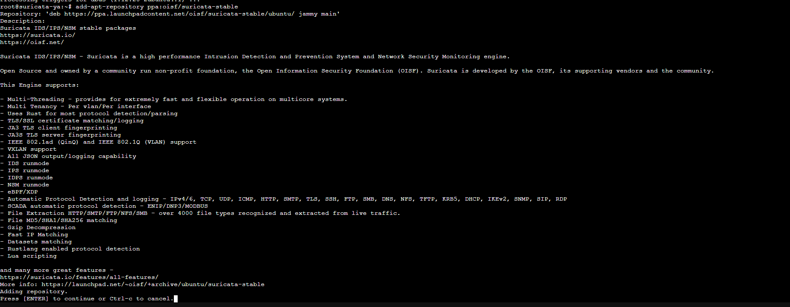
.png)
.png)

### 2.2 Téléchargement des règles de détection

**Télécharger et extraire le jeu de règles Emerging Threats pour Suricata :**

```bash
cd /tmp/ && curl -LO [https://rules.emergingthreats.net/open/suricata-6.0.8/emerging.rules.tar.gz](https://rules.emergingthreats.net/open/suricata-6.0.8/emerging.rules.tar.gz)
sudo tar -xvzf emerging.rules.tar.gz && sudo mkdir -p /etc/suricata/rules && sudo mv rules/*.rules /etc/suricata/rules/
sudo find /etc/suricata/rules -name "*.rules" -exec chmod 777 {} \;
```


.png)
.png)

### 2.3 Configuration de Suricata

Il est nécessaire de modifier les paramètres de Suricata dans le fichier */etc/suricata/suricata.yaml* afin de définir le réseau à surveiller et l'interface réseau.

**Définir les variables de réseau :**

```YAML
HOME_NET: "<IP_DE_LA_MACHINE_UBUNTU_22.04>"
EXTERNAL_NET: "any"

default-rule-path: /etc/suricata/rules
rule-files:
  - "*.rules"

# Configuration globale des statistiques
stats:
  enabled: yes
```

Définir l'interface réseau à écouter (remplacer *enp0s3* par le nom réel de l'interface de la machine, qui peut être obtenu via la commande *ip a* :

```YAML
# Prise en charge de la capture haute vitesse Linux
af-packet:
  - interface: enp0s3
```

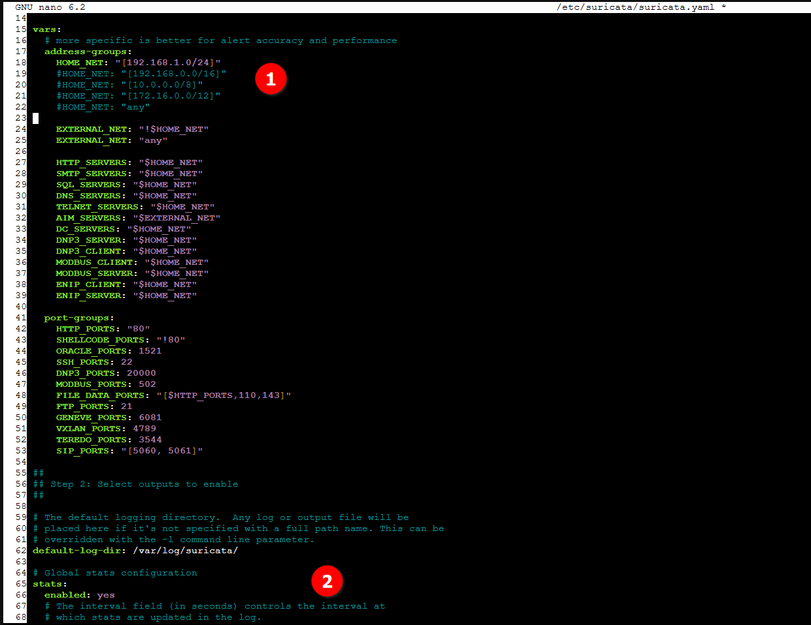

Redémarrer le service Suricata pour appliquer les modifications :

```BASH
sudo systemctl restart suricata
```

## 3. Configuration de l'agent Wazuh

Afin que l'agent Wazuh puisse lire et transmettre les alertes générées par Suricata, il faut modifier la configuration locale de l'agent.

Ajouter le bloc de configuration suivant dans le fichier */var/ossec/etc/ossec.conf* de la machine cible (Ubuntu) :

```XML
 <ossec_config>
  <localfile>
    <log_format>json</log_format>
    <location>/var/log/suricata/eve.json</location>
  </localfile>
</ossec_config>
```

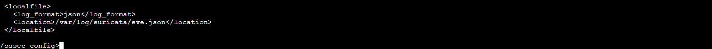

Redémarrer l'agent Wazuh pour appliquer les changements :

```BASH
sudo systemctl restart wazuh-agent
```

## 4. Simulation d'attaque et vérification

Wazuh analyse désormais automatiquement les données du fichier */var/log/suricata/eve.json* et génère les alertes correspondantes sur le tableau de bord.

### 4.1 Émulation

Pour vérifier le bon fonctionnement, générer un trafic ICMP (Ping) depuis le serveur Wazuh (ou une autre machine) vers la machine cible Ubuntu surveillée par Suricata :

```Bash
 ping -c 20 "<IP_DE_LA_MACHINE_UBUNTU>"
```

### 4.2 Visualisation des alertes

Il est possible de visualiser les données d'alerte directement dans le tableau de bord Wazuh.

Pour ce faire :

* Accéder au module Threat Hunting.
* Ajouter le filtre suivant dans la barre de recherche pour isoler les événements du NIDS : rule.groups:suricata.

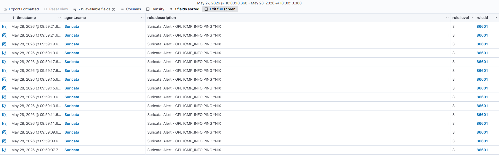

## 5. Dépannage (Troubleshooting)

En cas d'erreur de démarrage de Suricata, il est fréquent de rencontrer l'erreur suivante dans les journaux (*/var/log/suricata/suricata.log*) :

```plaintext
16/9/2022 -- 12:32:16 - <Error> - [ERRCODE: SC_ERR_AFP_CREATE(190)] - Unable to find iface eth0: No such device
16/9/2022 -- 12:32:16 - <Error> - [ERRCODE: SC_ERR_AFP_CREATE(190)] - Couldn't init AF_PACKET socket, fatal error
```

**Résolution :** Ce problème survient lorsque le nom de l'interface réseau renseigné dans la configuration est incorrect. Il convient de vérifier le nom exact de l'interface réseau disponible sur le système (*ip a*) et de corriger la directive interface dans le fichier */etc/suricata/suricata.yaml*.

* Surveillance de l'intégrité de répertoires/fichiers sensibles : https://documentation.wazuh.com/current/proof-of-concept-guide/poc-file-integrity-monitoring.html

# Surveillance de l'intégrité des fichiers (FIM)

Le contrôle d'intégrité des fichiers (File Integrity Monitoring - FIM) permet d'auditer les fichiers sensibles et de répondre aux exigences de conformité réglementaire. Wazuh dispose d'un module FIM intégré qui surveille les modifications du système de fichiers afin de détecter la création, la modification et la suppression de fichiers.

Ce cas d'usage exploite le module FIM de Wazuh pour détecter les modifications dans des répertoires surveillés sur des points de terminaison Linux et Windows. Le module enrichit les données d'alerte en récupérant des informations sur l'utilisateur et le processus à l'origine des modifications.

## 1. Infrastructure requise

* **Serveur Linux (Ubuntu 22.04) :** Le module FIM surveillera un répertoire spécifique sur cette machine cible pour détecter les changements de fichiers.
* **Poste Client (Windows 11) :** Le module FIM surveillera un répertoire spécifique sur ce point de terminaison pour détecter les mêmes types d'événements.

## 2. Configuration

### 2.1 Configuration de la machine cible Ubuntu

Les étapes suivantes permettent de configurer l'agent Wazuh pour surveiller les modifications du système de fichiers dans le répertoire `/root` (ou tout autre répertoire de test).

1. Éditer le fichier de configuration de l'agent Wazuh `/var/ossec/etc/ossec.conf`.
2. Ajouter le répertoire à surveiller dans le bloc `<syscheck>`. Pour obtenir des informations supplémentaires (audit complet en temps réel et reporting des changements), la configuration suivante doit être utilisée :

```xml
<directories check_all="yes" report_changes="yes" realtime="yes">/root</directories>
```

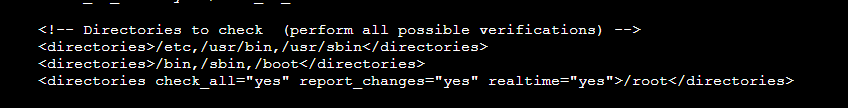

1. Redémarrer l'agent Wazuh pour appliquer les modifications de configuration :

```bash
sudo systemctl restart wazuh-agent
```

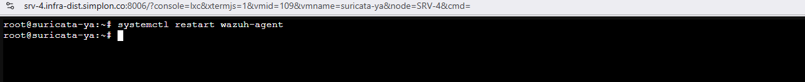

### 2.2 Configuration de la machine cible Windows

Les étapes suivantes permettent de configurer l'agent Wazuh pour surveiller les modifications dans le répertoire du bureau de l'utilisateur.

1. Ouvrir le fichier de configuration *C:\Program Files (x86)\ossec-agent\ossec.conf* sur la machine Windows surveillée (avec des droits d'administrateur).
2. Ajouter le répertoire à surveiller dans le bloc <*syscheck*>. Il faut remplacer <*USER_NAME*> par le nom de l'utilisateur de la session Windows 11 :

```XML
<directories check_all="yes" report_changes="yes" realtime="yes">C:\Users\<USER_NAME>\Desktop</directories>
```

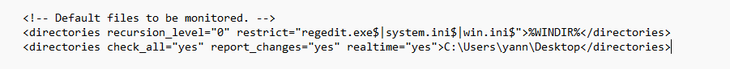

1. Redémarrer le service de l'agent Wazuh à l'aide de PowerShell (lancé en tant qu'administrateur) pour appliquer les changements :

```PowerShell
Restart-Service -Name wazuh
```

## 3. Test et simulation

Afin de vérifier que le module FIM remonte correctement les informations, il faut simuler une activité suspecte sur les deux machines (Ubuntu et Windows) dans les répertoires surveillés :

1. Créer un fichier texte dans le répertoire surveillé.
2. Attendre 5 secondes.
3. Ajouter du contenu au fichier texte, puis l'enregistrer.
4. Attendre 5 secondes.
5. Supprimer le fichier texte du répertoire surveillé.

## 4. Visualisation des alertes

Il est possible de visualiser les données d'alerte générées par ces actions directement dans le tableau de bord Wazuh.

Pour ce faire :

1. Se rendre dans le module File Integrity Monitoring (ou Threat Hunting) de l'interface web.
2. Ajouter le filtre suivant dans la barre de recherche pour interroger spécifiquement les alertes de création, modification et suppression de fichiers :

   * rule.id: is one of 550,553,554

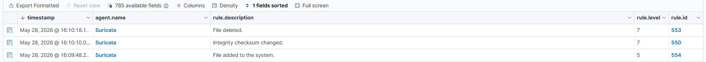
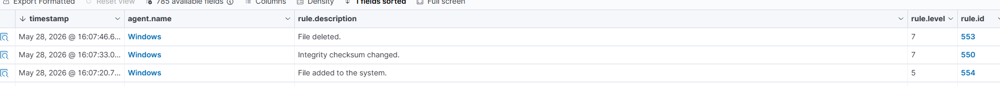

* Détection d'attaques bruteforce : https://documentation.wazuh.com/current/proof-of-concept-guide/detect-brute-force-attack.html

# Détection d'une attaque par force brute (Brute-force)

L'attaque par force brute est un vecteur d'attaque courant utilisé par des acteurs malveillants pour obtenir un accès non autorisé à des points de terminaison et à des services. Les services tels que SSH sur les serveurs Linux et RDP sur les postes Windows sont particulièrement exposés à ce type de menace. Wazuh identifie ces attaques en corrélant plusieurs événements d'échec d'authentification successifs.

Ce cas d'usage démontre comment simuler et détecter une attaque par force brute visant les protocoles SSH et RDP.

## 1. Infrastructure requise

Afin de réaliser ce scénario, trois rôles (ou machines) sont nécessaires :

* **Machine de l'attaquant :** Un système Linux (ex: Ubuntu) depuis lequel l'attaque sera lancée. *Note : Dans un environnement de laboratoire restreint, la machine hébergeant la sonde Suricata peut jouer ce rôle.*
* **Cible Linux (Ubuntu 24.04) :** La victime des attaques SSH. Il est requis d'avoir un serveur SSH installé, activé et supervisé par l'agent Wazuh sur cette machine.
* **Cible Windows (Windows 11) :** La victime des attaques RDP. Le bureau à distance (RDP) doit être activé sur ce point de terminaison.

## 2. Configuration de l'attaquant

Les étapes suivantes permettent de configurer la machine de l'attaquant pour générer des tentatives d'authentification échouées sur les cibles.

Sur la machine de l'attaquant, installer l'outil de sécurité **Hydra**, qui permet d'exécuter l'attaque par dictionnaire :

```bash
sudo apt update
sudo apt install -y hydra
```

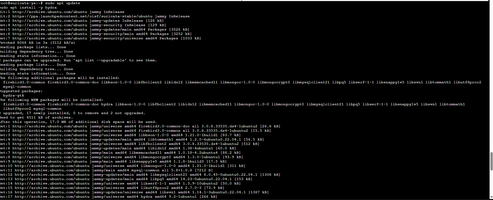

## 3. Émulation de l'attaque

### 3.1 Préparation du dictionnaire

Créer un fichier texte contenant une liste de mots de passe aléatoires (par exemple, 10 mots de passe erronés) qui serviront pour l'attaque.

```bash
nano pass.txt
```

### 3.2 Attaque contre le serveur Linux (SSH)

Exécuter Hydra depuis la machine de l'attaquant pour lancer l'attaque par force brute contre le service SSH. Remplacer <*IP_LINUX*> par l'adresse IP de la cible Ubuntu surveillée :

```bash
sudo hydra -l badguy -P pass.txt ssh://<IP_LINUX>
```

(Variante de syntaxe selon la version d'Hydra : *sudo hydra -l badguy -P pass.txt <IP_LINUX> ssh*)

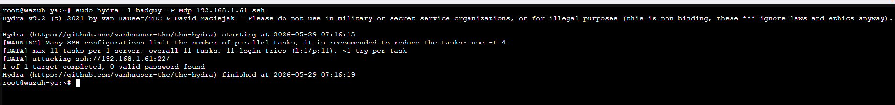

### 3.3 Attaque contre le poste Windows (RDP)

De la même manière, exécuter Hydra pour cibler le service Bureau à distance (RDP) du poste client Windows. Remplacer <*IP_WINDOWS*> par l'adresse IP de la cible Windows 11 :

```bash
sudo hydra -l badguy -P pass.txt rdp://<IP_WINDOWS>
```

## 4. Visualisation des alertes

Une fois les attaques lancées, les échecs d'authentification répétés sont automatiquement analysés par Wazuh, qui va déclencher des alertes de sécurité de niveau critique ou élevé.

Il est possible de visualiser ces données directement dans le tableau de bord.
Pour ce faire :

1. Accéder au module Threat Hunting dans l'interface web de Wazuh.
2. Ajouter les filtres suivants dans la barre de recherche pour interroger les alertes spécifiques à ces attaques :

Pour la cible Linux (SSH) :

* rule.id:(5551 OR 5712)
  (D'autres règles connexes peuvent également apparaître, telles que 5710, 5711, 5716, 5720, 5503, 5504).

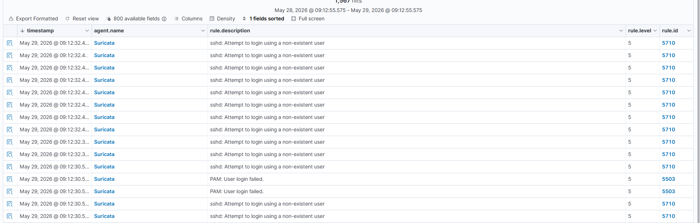

Pour la cible Windows (RDP) :

* rule.id:(60122 OR 60204)

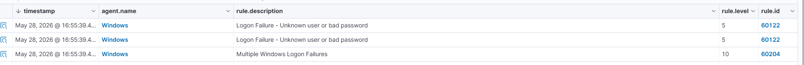

* Détection de processus non autorisés : https://documentation.wazuh.com/current/proof-of-concept-guide/detect-unauthorized-processes-netcat.html

# Détection de processus non autorisés (Monitoring de commandes)

La fonctionnalité de surveillance des commandes de Wazuh permet d'exécuter périodiquement des instructions sur un point de terminaison et d'en analyser la sortie.

Ce cas d'usage exploite cette capacité pour détecter l'exécution d'un processus spécifique non autorisé, en l'occurrence **Netcat** (souvent utilisé de manière illégitime pour l'écoute ou le balayage de ports), sur une machine cible.

## 1. Infrastructure requise

* **Machine cible (Endpoint) :** Un serveur sous **Ubuntu 24.04**. Le module de surveillance des commandes y sera configuré pour détecter le lancement du processus Netcat.
* **Serveur Wazuh (Manager) :** Le serveur central qui hébergera les règles de détection personnalisées.

## 2. Configuration de la machine cible (Ubuntu)

Les étapes suivantes permettent de configurer la surveillance des commandes afin d'interroger périodiquement la liste des processus en cours d'exécution.

1. Ajouter le bloc de configuration suivant dans le fichier `/var/ossec/etc/ossec.conf` de l'agent Wazuh. Cela permet d'exécuter la commande `ps` toutes les 30 secondes :

```xml
<ossec_config>
  <localfile>
    <log_format>full_command</log_format>
    <alias>process list</alias>
    <command>ps -e -o pid,uname,command</command>
    <frequency>30</frequency>
  </localfile>
</ossec_config>
```

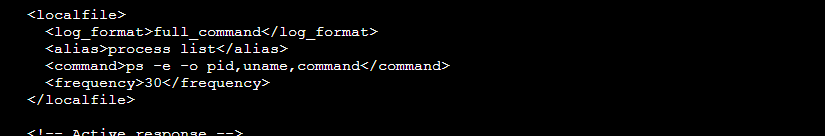

2. Redémarrer l'agent Wazuh pour appliquer les modifications :

```bash
sudo systemctl restart wazuh-agent
```

3. Installer Netcat (et ses dépendances) sur cette machine pour pouvoir simuler l'attaque ultérieurement :

```bash
sudo apt install ncat nmap -y
```

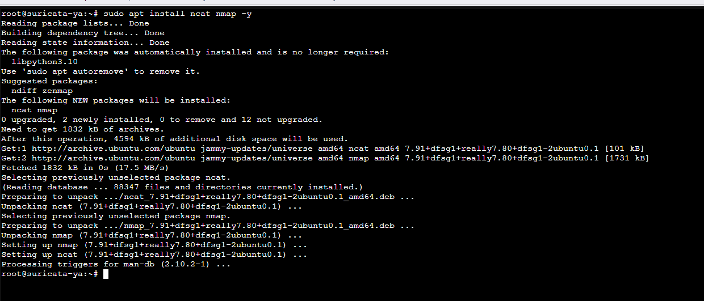

## 3. Configuration du serveur Wazuh (Manager)

Il est ensuite nécessaire de créer une règle personnalisée sur le serveur central pour qu'une alerte soit déclenchée chaque fois que le programme Netcat passe en mode écoute.

1. Ajouter les règles suivantes dans le fichier */var/ossec/etc/rules/local_rules.xml* sur le serveur Wazuh :

```XML
<group name="ossec,">
  <rule id="100050" level="0">
    <if_sid>530</if_sid>
    <match>^ossec: output: 'process list'</match>
    <description>List of running processes.</description>
    <group>process_monitor,</group>
  </rule>

  <rule id="100051" level="7" ignore="900">
    <if_sid>100050</if_sid>
    <match>nc -l</match>
    <description>netcat listening for incoming connections.</description>
    <group>process_monitor,</group>
  </rule>
</group>
```

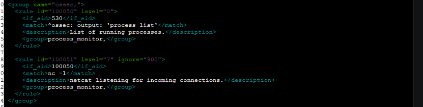

2. Redémarrer le service Wazuh Manager pour compiler et appliquer ces nouvelles règles :

```BASH
sudo systemctl restart wazuh-manager
```

## 4. Émulation de l'attaque

Pour vérifier le bon fonctionnement de la règle, il faut simuler le lancement d'un processus non autorisé sur la machine cible.

Sur la machine Ubuntu surveillée, exécuter la commande Netcat en mode écoute sur le port 8000 et la laisser tourner pendant au moins 30 secondes (pour laisser le temps au script de l'agent de s'exécuter) :

```BASH
nc -l 8000
```


## 5.  Visualisation des alertes

Les données d'alerte peuvent désormais être consultées dans le tableau de bord Wazuh.

Pour ce faire :

1. Accéder au module Threat Hunting.
2. Ajouter le filtre suivant dans la barre de recherche pour isoler spécifiquement la règle personnalisée fraîchement créée :

   * rule.id:(100051)

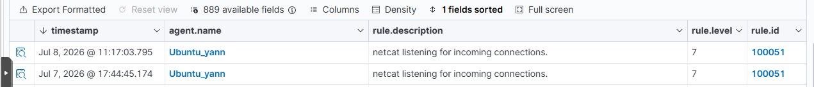

* Détection de tentatives d'injection SQL : https://documentation.wazuh.com/current/proof-of-concept-guide/detect-web-attack-sql-injection.html

# Détection d'une attaque par injection SQL (SQLi)

L'injection SQL est une attaque par laquelle un acteur malveillant insère du code non autorisé dans des chaînes de caractères transmises à un serveur de base de données pour être analysées et exécutées. Une attaque réussie permet d'obtenir un accès illégitime aux informations confidentielles de la base de données.

Wazuh permet de détecter ces tentatives en analysant les journaux du serveur web à la recherche de modèles courants d'injection SQL (comme les mots-clés `SELECT`, `UNION`, etc.).

Ce cas d'usage démontre comment configurer la surveillance d'un serveur web Apache et détecter une simulation d'attaque par injection SQL.

## 1. Infrastructure requise

* **Cible (Victime) :** Un serveur sous **Ubuntu 22.04** hébergeant un serveur web Apache (version 2.4.x). L'agent Wazuh y est configuré pour lire les journaux d'accès web.
* **Attaquant :** Une machine distante (ex: RHEL, Ubuntu ou la machine hôte) depuis laquelle la requête web malveillante sera lancée.

## 2. Configuration de la machine cible (Ubuntu)

Les étapes suivantes permettent d'installer le serveur web Apache et de configurer l'agent Wazuh pour en surveiller les journaux (logs).

### 2.1 Installation et vérification d'Apache

1. Mettre à jour les paquets locaux et installer le serveur web Apache :

```bash
sudo apt update
sudo apt install apache2 -y
```

1. Si le pare-feu (UFW) est activé sur le système, il est nécessaire d'autoriser le trafic web entrant. (Si le pare-feu est inactif, cette étape peut être ignorée) :

```bash
sudo ufw app list
sudo ufw allow 'Apache'
sudo ufw status
```

2. Vérifier que le service Apache est bien en cours d'exécution :

```bash
sudo systemctl status apache2
```

3. Valider l'accès au serveur web en utilisant la commande *curl* localement ou en ouvrant un navigateur web vers *http://<IP_DE_LA_MACHINE_UBUNTU>* pour afficher la page d'accueil par défaut d'Apache.

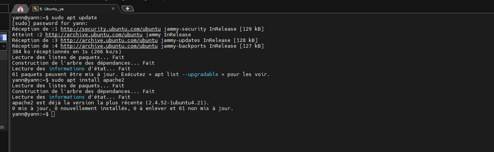
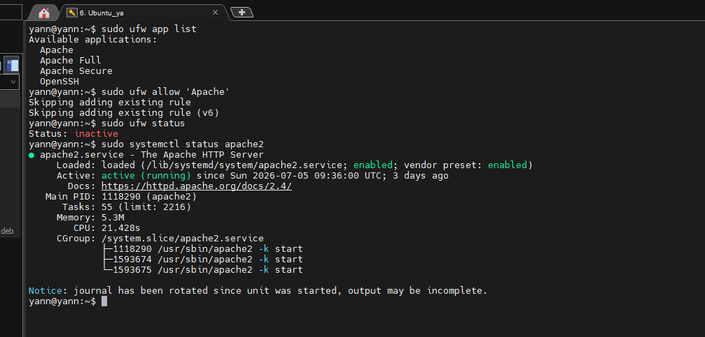
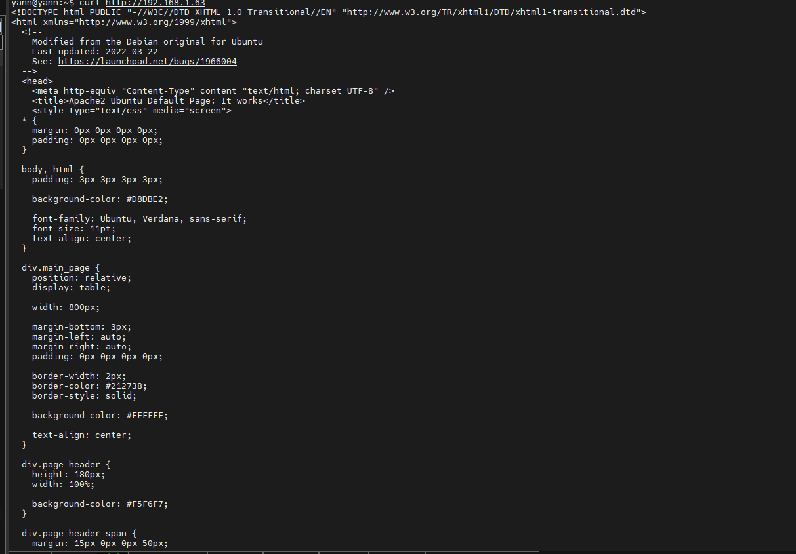

### 2.2 Configuration de l'agent Wazuh

Afin que Wazuh puisse analyser les requêtes web entrantes, l'agent doit être instruit de lire le fichier de journalisation d'Apache.

Ajouter les lignes suivantes au fichier de configuration de l'agent Wazuh */var/ossec/etc/ossec.conf* :

```xml
<ossec_config>
  <localfile>
    <log_format>apache</log_format>
    <location>/var/log/apache2/access.log</location>
  </localfile>
</ossec_config>
```

📸 [Capture d'écran : Le fichier *ossec.conf* ouvert sur la machine Ubuntu, mettant en évidence l'ajout du bloc *<localfile>* pointant vers */var/log/apache2/access.log*]

1. Redémarrer l'agent Wazuh pour appliquer les modifications de configuration :

```bash
sudo systemctl restart wazuh-agent
```

3. Émulation de l'attaque
   Pour tester la détection, il convient d'exécuter une requête HTTP contenant une charge utile (payload) d'injection SQL basique.

Depuis la machine de l'attaquant, exécuter la commande suivante (en remplaçant <IP_UBUNTU> par l'adresse IP de la cible) :

```bash
curl -XGET "http://<IP_UBUNTU>/users/?id=SELECT+*+FROM+users";
```

📸 [Capture d'écran : Le terminal de la machine attaquante exécutant la commande curl avec le payload SQLi. Le résultat affichera probablement le code source de la page d'accueil ou une erreur 404, mais l'essentiel est que la requête soit partie]

## 4. Visualisation des alertes

La requête malveillante a été enregistrée dans le fichier access.log d'Apache. L'agent Wazuh l'a transmise au Manager qui a identifié le modèle d'injection SQL.

Les données d'alerte peuvent être visualisées dans le tableau de bord Wazuh.
Pour ce faire :

1. Accéder au module Threat Hunting.
2. Ajouter l'un des filtres suivants dans la barre de recherche :

   * rule.id: 31103 (Détecte une attaque par injection SQL générique via requête web)
   * rule.id: 31106 (Détecte une tentative d'injection SQL qui a potentiellement réussi - code HTTP 200)

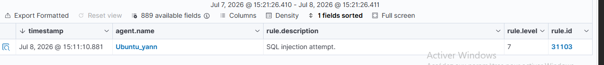

* Détection de cheval de troie : https://documentation.wazuh.com/current/proof-of-concept-guide/poc-detect-trojan.html


Traitement de malware à travers l'intégration de VirusTotal : https://documentation.wazuh.com/current/proof-of-concept-guide/detect-remove-malware-virustotal.html
* Détection de vulnérabilités : https://documentation.wazuh.com/current/proof-of-concept-guide/poc-vulnerability-detection.html

# Détection de vulnérabilités (Vulnerability Detector)

Ce cas d'usage démontre comment Wazuh identifie les vulnérabilités (CVE) non corrigées sur les applications et les systèmes d'exploitation des endpoints surveillés.

Le fonctionnement repose sur le module Syscollector de l'agent (qui dresse un inventaire des paquets installés) et le module Vulnerability Detection du Manager (qui croise cet inventaire avec les bases de données mondiales de menaces - CTI).

## 1. Infrastructure requise

   * **Serveur Wazuh (Manager)** : Le serveur central qui analysera l'inventaire des agents et générera les alertes.

   * **Machine cible (Endpoint)** : Un serveur Linux (ex: Ubuntu 22.04). Le module Syscollector y sera configuré pour remonter la liste des paquets installés.

## 2. Configuration du Serveur Wazuh (Manager)

Il faut s'assurer que le module de détection des vulnérabilités est bien activé sur le serveur central.

1. Éditer le fichier de configuration principal du Manager :

```bash
sudo nano /var/ossec/etc/ossec.conf
```

2. Rechercher le bloc <vulnerability-detection> et vérifier que les paramètres suivants sont configurés ainsi (l'activation est normalement par défaut sur les versions récentes) :

```xml
<vulnerability-detection>
  <enabled>yes</enabled>
  <index-status>yes</index-status>
  <feed-update-interval>60m</feed-update-interval>
</vulnerability-detection>
```

1. Redémarrer le service Wazuh Manager si des modifications ont été apportées :

```bash
sudo systemctl restart wazuh-manager
```

## 3. Configuration de l'Agent cible (Linux)

Par défaut, l'agent Wazuh scanne les paquets installés toutes les heures (1h). Pour les besoins de ce test (PoC), nous allons réduire cet intervalle à 10 minutes afin de ne pas bloquer la démonstration.

1. Sur la machine cible, éditer le fichier de configuration de l'agent :

```xml
sudo nano /var/ossec/etc/ossec.conf
```


2. Rechercher le bloc <syscollector> et modifier la valeur <interval> :

```xml
<syscollector>
  <disabled>no</disabled>
  <interval>10m</interval> <os>yes</os>
  <packages>yes</packages>
  <hotfixes>yes</hotfixes>
</syscollector>
```

3. Redémarrer l'agent Wazuh pour appliquer la configuration :

```bash
sudo systemctl restart wazuh-agent
```

## 4. Émulation de l'attaque (Injection de vulnérabilité)

Pour que Wazuh détecte une faille, nous allons volontairement installer une version obsolète et vulnérable d'un logiciel très connu : l'éditeur de texte Vim.

1. Sur l'agent cible, installer une version spécifique et vulnérable :
(La version exacte peut varier selon les dépôts disponibles, l'objectif est de forcer une ancienne version).

```Bash
sudo apt-get install vim=2:8.1.2269-1ubuntu5
```

2. Patience : Attendre environ 10 minutes (le temps défini dans le syscollector) qu'un nouveau scan d'inventaire s'exécute en arrière-plan et remonte l'information au Manager.

## 5. Visualisation des alertes

Une fois le délai écoulé, la détection doit être visible sur l'interface graphique.

### 5.1 Visionner l'inventaire des vulnérabilités

1. Dans le menu principal de Wazuh, aller dans Vulnerability Detection puis cliquer sur l'onglet Inventory.

2. Cliquer sur + Add filter pour isoler notre test :

   * Field : package.name

   * Operator : is

   * Value : vim

3. Le tableau affichera toutes les CVE (Common Vulnerabilities and Exposures) critiques et moyennes associées à cette version spécifique de Vim.

### 5.2 Visionner les événements

1. Toujours dans Vulnerability Detection, basculer sur l'onglet Events.

2. Les logs indiqueront exactement à quelle heure le paquet vulnérable a été découvert sur le système, déclenchant des alertes de vulnérabilité (par exemple, la règle 23504 pour une CVE de gravité élevée).

## 6. Test de remédiation (Résolution)

Wazuh est capable de détecter dynamiquement quand une faille a été corrigée par l'administrateur.

1. Retourner sur la machine cible et mettre à jour (ou supprimer) le paquet Vim :

```bash
sudo apt-get remove vim
# OU
sudo apt-get upgrade vim
```

2. Attendre de nouveau le passage du Syscollector (environ 10 minutes).

3. Sur le Dashboard Wazuh (Onglet Events), une nouvelle alerte apparaîtra indiquant que la vulnérabilité a le statut Solved (Résolue) ou que l'inventaire est désormais propre.

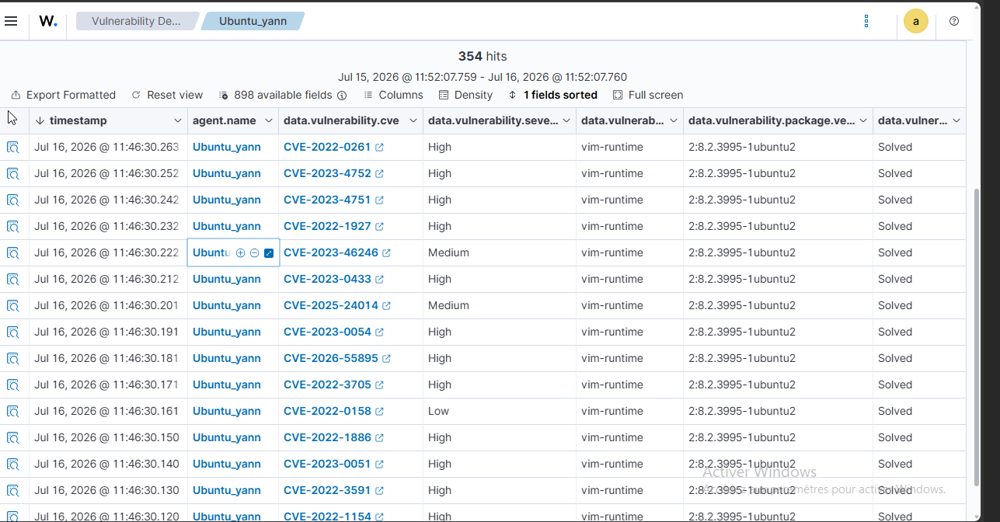

* Détection de processus cachés par rootkit : https://documentation.wazuh.com/current/proof-of-concept-guide/poc-detect-hidden-process.html

# Procédure : Détection d'un processus caché (Rootkit / Process Hiding)

## 1. Objectif

Valider la capacité de détection du module Rootcheck de Wazuh. Cette procédure consiste à simuler l'injection d'un rootkit noyau (Diamorphine) sur un endpoint pour vérifier que l'agent est capable d'identifier les incohérences entre la table des processus du noyau et la vue des outils utilisateurs (ps).

## 2. Configuration de l'Agent (Endpoint)

Pour permettre une détection réactive, la fréquence de scan a été optimisée :

1. **Modification de la configuration** : Éditer /var/ossec/etc/ossec.conf sur l'agent.

2. **Ajustement de la fréquence** : Dans le bloc <rootcheck>, définir la fréquence de scan à 120 secondes (2 minutes).

```xml
<rootcheck>
  <disabled>no</disabled>
  <check_pids>yes</check_pids>
  <frequency>120</frequency>
</rootcheck>
```

3. **Application** : Redémarrer l'agent pour appliquer les changements :

```bash
sudo systemctl restart wazuh-agent
```

## 3. Emulation de l'Attaque (Rootkit Diamorphine)

*Note : Cette étape nécessite un environnement de test isolé.*

1. **Compilation** : Récupération du code source et compilation du module noyau.

```bash
git clone https://github.com/m0nad/Diamorphine 
cd Diamorphine 
make
```

2. **Injection** : Charger le module dans le noyau Linux.

```bash
sudo insmod diamorphine.ko
```

3. **Masquage de processus** : Utiliser les signaux kill fournis par le rootkit pour rendre le processus rsyslogd invisible aux outils de reporting standard (ps aux).

## 4. Validation et Visualisation

La détection repose sur la corrélation des événements générés par le moteur Rootcheck :

1. **Accès Dashboard** : Threat Hunting > Section de recherche.

2. **Requête de corrélation** : Utiliser le filtre suivant pour isoler les alertes :

```plaintext
rule.groups:rootcheck
```

3. **Analyse des preuves** : Le dashboard affiche des alertes critiques de type "Process hidden" ou "Rootkit detection". Ces alertes confirment que Wazuh a détecté la divergence entre les processus réellement actifs et ceux rapportés par le système.

## 5. Analyse de l'incident

**Preuve technique** : L'alerte confirme que Wazuh a réussi à "voir" le processus rsyslogd via son module de surveillance système, alors même que le rootkit tentait de le supprimer de la liste des processus visibles.

* Remédiation :

  * Décharger le module noyau malveillant (rmmod).

  * Analyser l'intégrité du système.

  * Mettre en quarantaine l'endpoint pour une investigation forensique.

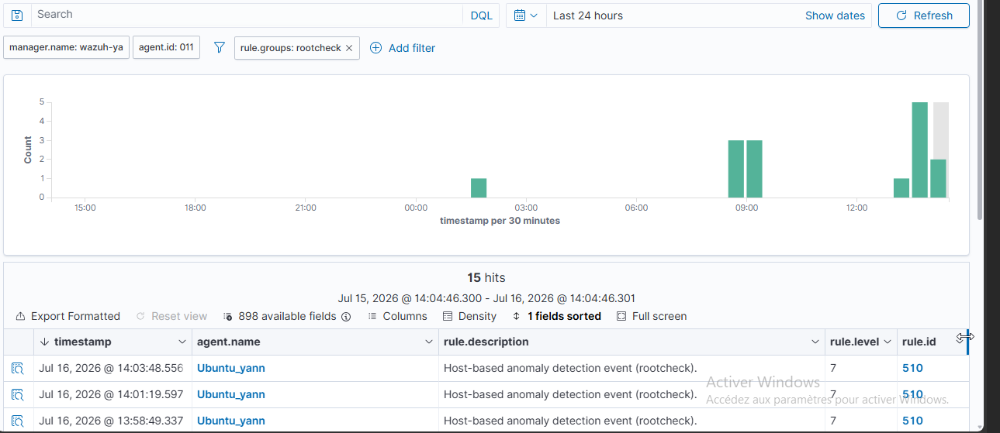
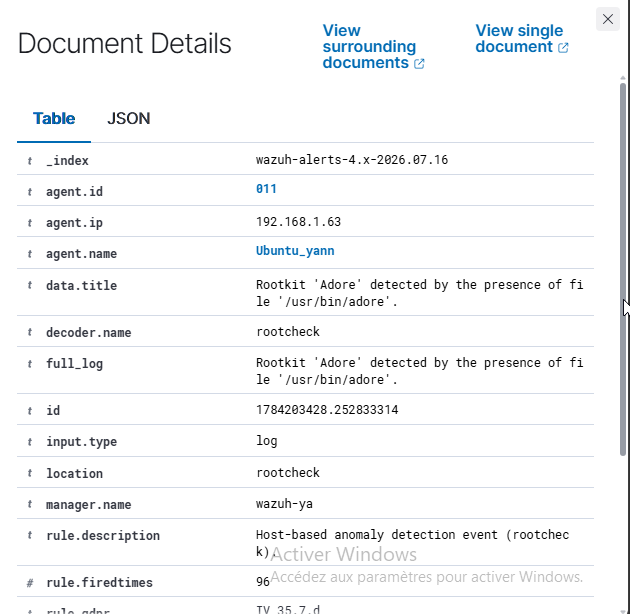

* Détection de commandes malveillantes : https://documentation.wazuh.com/current/proof-of-concept-guide/audit-commands-run-by-user.html

# Procédure : Surveillance de l'exécution de commandes malveillantes (Auditd)

## 1. Objectif

Configurer l'utilitaire natif Linux *auditd* sur l'agent pour tracer l'ensemble des commandes exécutées par un utilisateur (y compris via *sudo* ou *su*). L'objectif est ensuite d'utiliser les listes CDB (Constant Database) de Wazuh pour générer une alerte critique personnalisée lorsqu'un binaire spécifiquement identifié comme dangereux (ex: *netcat*) est exécuté.

## 2. Configuration de l'Agent (Endpoint Ubuntu)

Dans un premier temps, il faut configurer le système d'exploitation pour générer les journaux d'audit, puis indiquer à l'agent Wazuh de les lire.

### 2.1. Installation et configuration d'Auditd

1. **Installation du paquet** :

```Bash
sudo apt -y install auditd
sudo systemctl start auditd

```

2. **Création des règles d'audit** :
Ajouter les règles suivantes pour cibler l'utilisateur principal (UID 1000) et tracer les exécutions de commandes (*execve*) avec la clé d'identification *audit-wazuh-c*.

```Bash
sudo sh -c 'echo "-a exit,always -F auid=1000 -F egid!=994 -F auid!=-1 -F arch=b32 -S execve -k audit-wazuh-c" >> /etc/audit/audit.rules'

sudo sh -c 'echo "-a exit,always -F auid=1000 -F egid!=994 -F auid!=-1 -F arch=b64 -S execve -k audit-wazuh-c" >> /etc/audit/audit.rules'
```

3. **Application et vérification des règles** :


```Bash
sudo auditctl -R /etc/audit/audit.rules
sudo auditctl -l
```

### 2.2. Configuration de l'Agent Wazuh

1. **Lecture des logs** : Éditer le fichier /var/ossec/etc/ossec.conf de l'agent pour y ajouter le bloc suivant afin de collecter les événements auditd :

```XML
<localfile>
  <log_format>audit</log_format>
  <location>/var/log/audit/audit.log</location>
</localfile>
```

2. Redémarrage de l'agent :

```Bash
sudo systemctl restart wazuh-agent
```

## 3. Configuration du Manager (Wazuh Server)

Cette étape consiste à créer une base de données de surveillance (liste CDB) et une règle de détection sur mesure.

### 3.1. Création de la liste des programmes suspects (CDB List)

1. **Création du fichier de liste** :

```Bash
sudo nano /var/ossec/etc/lists/suspicious-programs
```

2. **Ajout du contenu (Format Clé:Valeur)** :

```Plaintext
ncat:yellow
nc:red
tcpdump:orange
```

3. **Déclaration de la liste** : Éditer le fichier */var/ossec/etc/ossec.conf* du **Manager**, localiser la section <ruleset> et y ajouter :

```XML
<list>etc/lists/suspicious-programs</list>
```

### 3.2. Création de la règle de corrélation

1. **Édition des règles locales** :

```Bash
sudo nano /var/ossec/etc/rules/local_rules.xml
```

2.**Ajout de la règle d'alerte (Niveau 12 - Haute sévérité)** :
Cette règle se déclenche (ID 100210) si l'événement correspond à la règle parente d'Auditd (80792) ET si la commande exécutée a la valeur red dans notre liste CDB.

```XML
<group name="audit">
  <rule id="100210" level="12">
      <if_sid>80792</if_sid>
      <list field="audit.command" lookup="match_key_value" check_value="red">etc/lists/suspicious-programs</list>
      <description>Audit: Highly Suspicious Command executed: $(audit.exe)</description>
      <group>audit_command,</group>
  </rule>
</group>
```

3. **Application de la configuration** :  

```Bash
sudo systemctl restart wazuh-manager
```

## 4. Émulation de l'Attaque  

Sur l'agent Ubuntu, installer et exécuter l'outil netcat (défini comme programme red dans notre liste) :  

```Bash
sudo apt -y install netcat
nc -v
```

## 5. Validation et Visualisation

La détection valide la bonne intégration d'Auditd et la réactivité des listes CDB.

1. Accès Dashboard : Threat Hunting > Section de recherche.

2. Requête de corrélation : Utiliser les filtres suivants pour isoler l'alerte :

```Plaintext
data.audit.command:nc
```

*Ou filtrer directement sur l'ID de règle : rule.id:100210*

3. Analyse de l'alerte : Une alerte de niveau 12 nommée "*Audit: Highly Suspicious Command executed: /usr/bin/nc*" apparaîtra dans le tableau de bord.

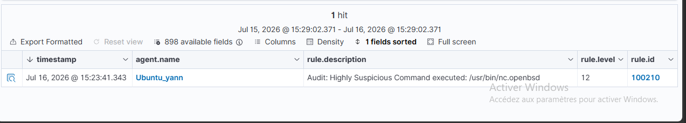

* Détection d'attaques shellshock : https://documentation.wazuh.com/current/proof-of-concept-guide/detect-web-attack-shellshock.html