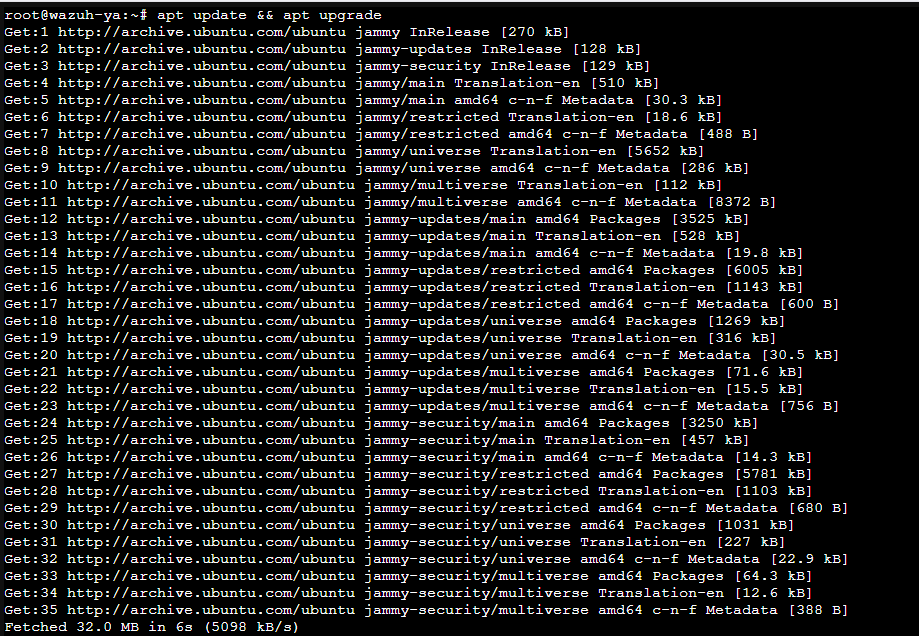
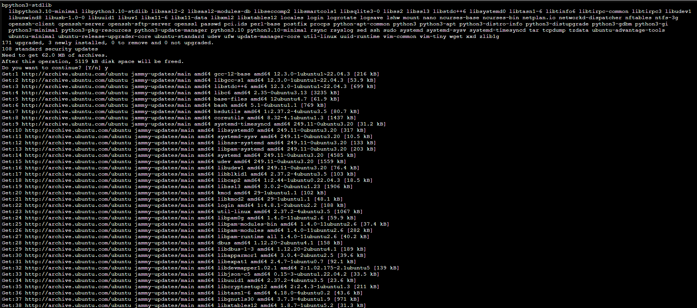
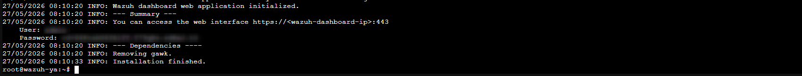

<p align="center">
  
</p>


**Auteur** : Yann (Administrateur Infrastructure Sécurisée)

**Projet** : Juin 2026


## Déploiement de la plateforme Wazuh (Quickstart)

Wazuh est une solution de sécurité open-source combinant des fonctionnalités XDR (protection des terminaux) et SIEM (gestion des événements). La solution repose sur un agent universel et trois composants centraux : le serveur (Manager), l'Indexer et le Dashboard. 

Pour ce projet, nous utilisons la méthode d'installation *Quickstart*, qui permet de déployer ces trois composants centraux sur un seul et même hôte.

### 1. Prérequis

**Prérequis système**
L'installation nécessite un processeur 64-bit. Pour ce déploiement, nous utilisons un environnement **Ubuntu 24.04**

**Prérequis matériels**
Les ressources nécessaires dépendent du nombre de machines supervisées. Pour un déploiement *All-in-one* avec 90 jours de rétention des logs, voici les recommandations :

| Nombre d'agents | CPU | RAM | Stockage (90 jours) |
| :--- | :--- | :--- | :--- |
| **1 à 25** | 4 vCPU | 8 Go | 50 Go |
| **25 à 50** | 8 vCPU | 8 Go | 100 Go |
| **50 à 100** | 8 vCPU | 8 Go | 200 Go |

### 2. Installation de Wazuh

Sur le serveur Ubuntu, télécharger et exécuter l'assistant d'installation avec l'option `-a` (pour tout installer sur la même machine) :

```bash
curl -sO [https://packages.wazuh.com/4.14/wazuh-install.sh](https://packages.wazuh.com/4.14/wazuh-install.sh) && sudo bash ./wazuh-install.sh -a
```

Une fois le script terminé, le terminal affichera un message de succès ainsi que les identifiants de connexion :

INFO: --- Summary ---
INFO: You can access the web interface https://<IP_DE_DU_SERVEUR>
    User: admin
    Password: <MOT_DE_PASSE_GENERE>
INFO: Installation finished.



.png)


**Note :** Tu peux trouver les mots de passe de tous les utilisateurs de l'indexeur Wazuh et de l'API Wazuh dans le fichier wazuh-passwords.txt à l'intérieur de l'archive wazuh-install-files.tar. Pour les imprimer, exécute la commande suivante :

```bash
sudo tar -O -xvf wazuh-install-files.tar wazuh-install-files/wazuh-passwords.txt
```

**Désinstallation :** Si tu souhaites désinstaller les composants centraux de Wazuh ultérieurement, il suffit d'exécuter l'assistant d'installation de Wazuh en utilisant l'option -u ou --uninstall.

### 3. Accès au Dashboard

1. Ouvre le navigateur et se rendre sur https://<IP_DU_SERVEUR>.

2. Connecte-toi avec l'utilisateur admin et le mot de passe fourni à l'étape précédente.


.png)

### 4. Post-installation : Désactiver les mises à jour

**Action recommandée : désactiver les mises à jour de Wazuh**

Il est recommandé de désactiver les référentiels de packages Wazuh après l'installation pour éviter les mises à niveau accidentelles qui pourraient briser l'environnement.

Exécute la commande suivante pour désactiver le référentiel Wazuh (version APT pour Ubuntu :

```bash
sudo sed -i "s/^deb/#deb/" /etc/apt/sources.list.d/wazuh.list
```