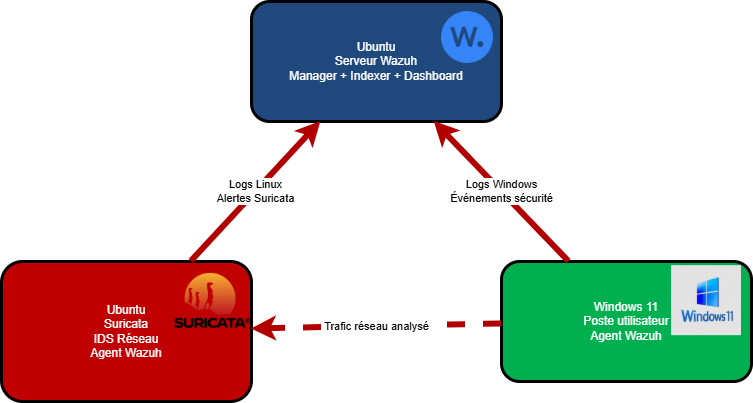

# Supervision de sécurité avec Wazuh

Déploiement d'une plateforme Wazuh, supervision d'endpoints et détection d'incidents.

## Contenu
1. [Installation et configuration de Wazuh](./1_installation.md)
2. [Déploiement de la surveillance de sécurité](./2_deploiement.md)
3. [Explorer les capacités de Wazuh (cas d'usage de la documentation officielle)](./3_use_cases.md)

## Ce que le projet couvre
- Détection d'une attaque par injection SQL
- Intégration d'un NIDS (Suricata)
- Détection de brute force SSH et RDP, surveillance de l'intégrité des fichiers (FIM)